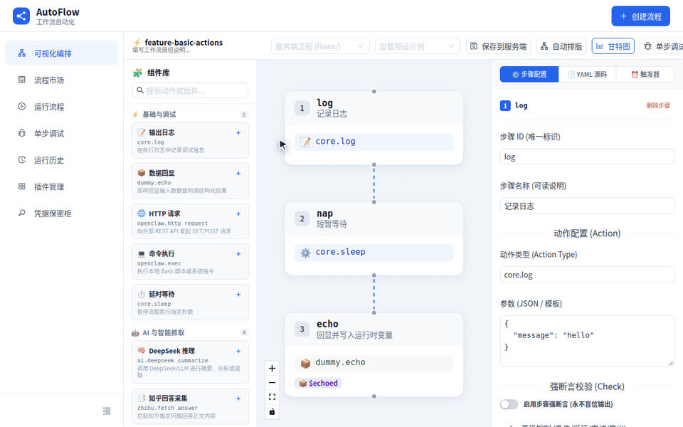

<div align="center">

# AutoFlow

**Deterministic DAG automation & step-debugger engine (Trigger → Action → Check) for AI agent teams.**

[](https://github.com/mcocdaa)
[](https://github.com/mcocdaa/AutoFlow/actions/workflows/ci.yml)
[](https://github.com/mcocdaa/AutoFlow/releases)
[](https://www.python.org/)
[](docker-compose.yml)
[](LICENSE)

[English](README.md) · [简体中文](README_CN.md)



</div>

**AutoFlow** is the deterministic execution layer for AI agent teams—agents propose workflows, and AutoFlow executes them with verifiable assertions, step-by-step time-travel debugging, and full artifact auditability. Frontend UI, REST API, and MCP server ship in a single container image.

## ✨ Highlights

- **Deterministic `Trigger → Action → Check` DAG Engine**: Execute declarative YAML workflows with retries, conditional branches (`when`), loops (`for_each`), and post-action assertions (`Check`).
- **Interactive Step-by-Step Debugger & Replay**: Create persistent debug sessions to step, continue to breakpoints, inspect variables, and replay historical runs on demand.
- **Unified Server Flow CRUD & Dynamic Plugin Catalog**: Shared `/api/v1/flows` storage and `/api/v1/plugins/catalog` schema introspection keep the visual DAG Canvas and AI agents 100% synchronized.
- **Native MCP Server (`/mcp`) & OpenClaw Integration**: Expose flow discovery, execution, status polling, replay, and artifact retrieval directly to Claude Code, Cursor, and OpenClaw agents.
- **AES-256-GCM Secrets Vault**: Manage encrypted credentials via `/api/v1/secrets` and inject them safely into steps with `{{secrets.NAME}}` without leaking plaintext in logs or YAML.
- **Full Observability & Artifact Offloading**: Record every step, check, iteration, and hook event; oversized outputs automatically offload to structured artifacts.

## 🚀 Quick Start

### Option 1: Docker Compose (Recommended — 1 Command)

```bash
cp .env.example .env && docker compose up -d --build
```

Open **<http://localhost:3001>** (Web Canvas UI, REST API, and Swagger `/docs` served on the same port).

### Option 2: Pre-built GHCR Image

```bash
docker run -d --name autoflow -p 3001:3000 ghcr.io/mcocdaa/autoflow:latest
```

### Option 3: Local Development

```bash
bash scripts/start.sh local          # Backend on :3001 + Frontend on :5180
bash scripts/start.sh local backend  # Backend only (:3001)
bash scripts/start.sh local frontend # Frontend only (:5180, proxies /api to :3001)
```

## 🤖 AI / API & MCP Usage

Create or update a flow via REST, execute it, or connect an MCP client to `/mcp`:

```bash
# 1. Save a Flow to the server (immediately visible in the Web Canvas UI)
curl -X PUT http://localhost:3001/api/v1/flows/hello-agent \
  -H "Content-Type: application/json" \
  -d '{
    "flow_yaml": "name: hello-agent\nsteps:\n  - id: greet\n    action: log\n    params:\n      message: \"Hello from AutoFlow!\"\n    check:\n      type: always_pass\n"
  }'

# 2. Execute a Flow run (inline YAML or saved flow)
curl -X POST http://localhost:3001/api/v1/runs/execute \
  -H "Content-Type: application/json" \
  --data "$(jq -n --rawfile f flows/hello-agent.flow.yaml '{flow_yaml:$f}')"

# 3. Inspect dynamic plugin catalog (Actions, Checks, Triggers & parameter schemas)
curl -s http://localhost:3001/api/v1/plugins/catalog | jq .

# 4. Native MCP Server endpoint (Streamable HTTP for Claude Code / Cursor / OpenClaw)
# Endpoint: http://localhost:3001/mcp
```

## ⚙️ Configuration & Docs

All runtime settings live in `.env` (copied from `.env.example`):

<details>
<summary>Environment Variables</summary>

| Variable | Default | Description |
|----------|---------|-------------|
| `BACKEND_EXTERNAL_PORT` | `3001` | Host port mapped to container port `3000` |
| `LOG_LEVEL` | `INFO` | Logging verbosity (`DEBUG`, `INFO`, `WARNING`, `ERROR`) |
| `CORS_ORIGINS` | `*` | Allowed CORS origins (comma-separated) |
| `VITE_API_PROXY_URL` | `http://localhost:3001` | Local frontend dev server proxy target |
| `AUTOFLOW_SECRETS_KEY` | *(auto)* | Master key for AES-256-GCM Secrets Vault |
| `DEEPSEEK_API_KEY` | *(empty)* | API key for the `ai-deepseek` summarization plugin |
| `ZHIHU_COOKIE` | *(empty)* | Cookie for the `zhihu` scraper plugin |
| `KNOWFLOW_BASE_URL` | *(empty)* | Base URL for KnowFlow knowledge base integration |
| `MCP_ENABLED` | `true` | Mount the `/mcp` Model Context Protocol server |
| `MCP_TOKEN` | *(empty)* | Optional Bearer token required for `/mcp` requests |
| `AUTOFLOW_AI_DRY_RUN` | *(empty)* | Dry-run toggle (`1`/`true`/`on`) for AI/plugin actions |

</details>

### Documentation & Resources

- 📚 [Documentation Index](docs/index.md) · [Architecture Overview](docs/architecture/index.md) · [Roadmap](docs/roadmap.md)
- 🔌 [MCP Server Guide](docs/en/modules/mcp.md) · [Plugin Development Guide](docs/en/plugin-dev-guide.md)
- 🧪 [Example Flows](docs/examples/index.md) (`docs/examples/engine/` covers all DAG capabilities)

> **Security Note**: `/api/v1/runs/execute` can run privileged plugin actions (such as `openclaw.exec`). Do not expose an unauthenticated instance directly to the public internet; deploy behind an internal network or authenticated reverse proxy.

## 📄 License

Released under the [MIT License](LICENSE).
